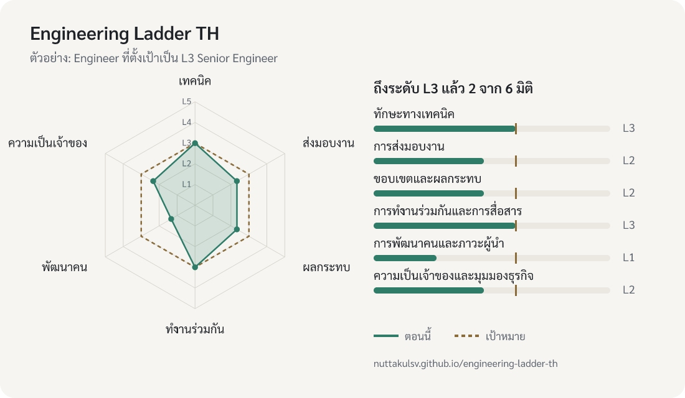

# engineering-ladder-th

ภาษาไทย | [English](README.en.md)

career ladder ของวิศวกรซอฟต์แวร์ภาษาไทย ทั้งสาย IC และสายบริหาร พร้อม playbook สำหรับ tech lead และเว็บให้ประเมินตัวเองแบบไม่ต้องติดตั้งอะไร บริษัทเอาไปปรับใช้ได้ภายในบ่ายเดียว

[](https://github.com/nuttakulsv/engineering-ladder-th/actions/workflows/ci.yml)
[](LICENSE)
[](LICENSE-CODE)

[](https://nuttakulsv.github.io/engineering-ladder-th/#t=ic&l=L3&v=1u9j4pm&c=____f75kCAAAAAAA)

**[ประเมินตัวเองบนเว็บ](https://nuttakulsv.github.io/engineering-ladder-th/)** เลือกสายและระดับที่ตั้งเป้า ติ๊กสิ่งที่ทำได้สม่ำเสมอ แล้วดูว่าแต่ละมิติยังขาดอะไร คำตอบเก็บอยู่ในลิงก์ของคุณเอง ไม่ถูกส่งไปที่ไหน แชร์ลิงก์ให้หัวหน้าก่อนคุย 1:1 ได้เลย (รูปด้านบนคือ[ตัวอย่างผลลัพธ์](https://nuttakulsv.github.io/engineering-ladder-th/#t=ic&l=L3&v=1u9j4pm&c=____f75kCAAAAAAA))

## ทำไมถึงมี repo นี้

บริษัทไทยส่วนใหญ่ที่มีทีม engineering 10–200 คน ยังไม่มีเกณฑ์ที่เขียนไว้ชัดว่า Senior ต่างจาก Engineer ยังไง หรือ Tech Lead ต่างจาก Senior ตรงไหน ผลที่ตามมาคือ

- ตำแหน่งได้มาจากอายุงานหรือจากการต่อรองตอนจะลาออก
- คนเก่งต้องไปเป็นหัวหน้าเพราะเป็นทางเดียวที่ได้ขึ้นเงินเดือน
- การประเมินขึ้นอยู่กับว่าหัวหน้าพูดเก่งแค่ไหนในห้อง calibration
- คนในทีมไม่รู้ว่าต้องทำอะไรเพิ่มถึงจะไปต่อได้

ladder ภาษาอังกฤษดี ๆ มีอยู่แล้วหลายฉบับ แต่การแปลตรง ๆ ไม่พอ เพราะทีมไทยมีเรื่องเฉพาะ เช่น ความเกรงใจรุ่นพี่ การไม่ติต่อหน้าคนอื่น และโครงสร้างบริษัทที่หัวหน้าทีมมักต้องทำทั้งงานเทคนิคและงานคน repo นี้เขียนขึ้นใหม่ทั้งหมดเป็นภาษาไทย โดยคิดเรื่องเหล่านี้ไว้ตั้งแต่ต้น

## ข้างในมีอะไร

| | |
|---|---|
| [ladder สาย IC](ladder/ic.md) | L1 Junior ถึง L5 Principal |
| [ladder สายบริหาร](ladder/em.md) | Engineering Manager, Senior EM, Head of Engineering |
| [ระดับ ชื่อตำแหน่ง และสองสายอาชีพ](guides/levels-and-titles.md) | Senior, Tech Lead, Staff ต่างกันยังไง และการสลับสาย IC กับ Manager |
| [วิธีใช้ ladder](guides/using-the-ladder.md) | อ่านยังไงไม่ให้กลายเป็น checklist |
| กระบวนการ | [calibration](guides/calibration.md), [การเลื่อนระดับ](guides/promotion.md), [ปรับใช้กับบริษัทของคุณ](guides/adapting.md) |
| playbook ของ tech lead | [90 วันแรก](guides/first-90-days.md), [1:1](guides/one-on-ones.md), [การให้ feedback](guides/feedback.md), [design review และ RFC](guides/design-reviews.md), [หนี้ทางเทคนิค](guides/tech-debt.md), [การมอบหมายงาน](guides/delegation.md), [incident และ postmortem](guides/incidents.md), [onboarding](guides/onboarding.md), [การสัมภาษณ์](guides/hiring.md) |
| [templates](templates/) | ประเมินตัวเอง, ประเมินโดยหัวหน้า, promotion packet, 1:1, postmortem, onboarding checklist, scorecard สัมภาษณ์ |

## หน้าตาของ ladder

แต่ละระดับมีหกมิติ ได้แก่ ทักษะทางเทคนิค การส่งมอบงาน ขอบเขตและผลกระทบ การทำงานร่วมกันและการสื่อสาร การพัฒนาคนและภาวะผู้นำ และความเป็นเจ้าของและมุมมองธุรกิจ แต่ละช่องเขียนเป็นสิ่งที่เห็นได้ในงานจริง ไม่ใช่คำคุณศัพท์ลอย ๆ ตัวอย่างหนึ่งช่อง

> **L3 Senior Engineer · การส่งมอบงาน**
>
> สิ่งที่เห็นได้ในงานจริง
> - นำโปรเจกต์ที่กินเวลาหลายสัปดาห์และมีคนร่วมทำ 2–4 คนจนสำเร็จ
> - เห็นความเสี่ยงของโปรเจกต์ตั้งแต่ต้น และทำส่วนที่ยากหรือไม่แน่นอนที่สุดก่อน
> - ตัดขอบเขตงานอย่างมีเหตุผลเมื่อเวลาไม่พอ โดยตกลงกับ product ไม่ใช่ตัดเงียบ ๆ
>
> ยังไม่ถึงระดับนี้ ถ้า โปรเจกต์ที่นำเลื่อนบ่อยและคนอื่นรู้ทีหลัง หรือทำส่วนง่ายก่อนแล้วไปเจอปัญหาใหญ่ตอนท้าย
>
> หลักฐานที่ใช้ตอนประเมิน: โปรเจกต์ที่นำ พร้อมไทม์ไลน์และการตัดสินใจระหว่างทาง
>
> ถ้าอยากไปถึง: ในโปรเจกต์ถัดไป เขียนความเสี่ยง 3 อันดับแรกตั้งแต่สัปดาห์แรก และทบทวนทุกสัปดาห์

| สาย IC | ขอบเขต | สายบริหาร | ขอบเขต |
|---|---|---|---|
| L1 Junior Engineer | งานย่อยที่มีคนแบ่งให้ | | |
| L2 Engineer | feature | | |
| L3 Senior Engineer | โปรเจกต์หรือส่วนของระบบ | | |
| L4 Staff Engineer / Tech Lead | ทั้งทีมหรือหลายทีม | M1 Engineering Manager | ทีมเดียว 4–8 คน |
| L5 Principal Engineer | ทั้งองค์กร | M2 Senior Engineering Manager | หลายทีม 15–40 คน |
| | | M3 Head of Engineering | engineering ทั้งบริษัท |

แถวเดียวกันหมายถึงขอบเขตงานใกล้เคียงกัน การไปเป็น manager จึงเป็นการเปลี่ยนงาน ไม่ใช่การเลื่อนขั้น

## ใช้ยังไง

**ถ้าคุณเป็นวิศวกร** เปิดเว็บ เลือกระดับที่อยากไป ติ๊กเฉพาะสิ่งที่ทำได้สม่ำเสมอ แล้วเอาลิงก์ผลไปคุยกับหัวหน้าใน 1:1 ช่อง "ลองทำ" ของแต่ละมิติคือสิ่งที่เริ่มทำได้ในไตรมาสนี้

**ถ้าคุณเป็น tech lead หรือ EM** เริ่มจาก [90 วันแรก](guides/first-90-days.md) และ [1:1](guides/one-on-ones.md) แล้วใช้ ladder เป็นภาษากลางเวลาคุยเรื่องการเติบโต ไม่ใช่ใบติ๊กตอนประเมิน

**ถ้าคุณเป็นบริษัท** fork repo นี้ แก้ `data/ladder.json` ให้ตรงกับบริษัท รัน `npm run build` แล้วเปิด GitHub Pages คุณจะได้ทั้งเอกสารและเว็บประเมินตัวเองเป็นของบริษัทเอง รายละเอียดอยู่ใน [ปรับใช้กับบริษัทของคุณ](guides/adapting.md)

## แก้ข้อมูลและรันบนเครื่อง

ต้องมี Node.js 20 ขึ้นไป ไม่มี dependency ให้ติดตั้ง

```bash
npm run build   # ตรวจข้อมูล สร้าง ladder/*.md และเว็บใน _site/
npm run check   # ตรวจว่าข้อมูลครบ ladder/*.md ตรงกับข้อมูล และลิงก์ในเอกสารไม่เสีย
npm test        # ทดสอบการคิดระดับ ลิงก์แชร์ และหน้าเว็บ
npm run dev     # build แล้วเปิดเว็บที่ http://localhost:8080
```

ตัวอย่างผลของ `npm run check`

```console
$ npm run check
ok (ic: 5 levels, 90 behaviors; em: 3 levels, 54 behaviors)
```

ถ้าข้อมูลขาด คำสั่งจะบอกตำแหน่งให้ เช่น `ic/L3/delivery: growth is empty`

## คำถามที่พบบ่อย

**ทำไมไม่มีตัวเลขเงินเดือน** เงินเดือนต่างกันมากตามอุตสาหกรรม ขนาดบริษัท และช่วงเวลา ตัวเลขที่ล้าสมัยสร้างความเสียหายมากกว่าไม่มี ดูวิธีจับคู่ ladder กับกระบอกเงินเดือนของคุณเองใน [adapting](guides/adapting.md)

**เว็บคิดระดับยังไง** ในแต่ละมิติ ระดับจะนับว่าถึงเมื่อติ๊ก 2 ใน 3 ของพฤติกรรมในระดับนั้น และต้องถึงทุกระดับก่อนหน้าด้วย เกณฑ์นี้ตั้งใจให้หยาบ เพราะผลจากเว็บมีไว้เปิดบทสนทนา ไม่ได้ตัดสินแทนคน

**เอาไปใช้ในบริษัทเชิงพาณิชย์ได้ไหม** ได้ เนื้อหาใช้ CC BY 4.0 แก้และใช้ภายในได้ทั้งหมด แค่ให้เครดิต เช่น "ดัดแปลงจาก engineering-ladder-th โดย nuttakulsv" พร้อมลิงก์ไปที่ repo นี้

**มีภาษาอังกฤษไหม** ตอนนี้มีเฉพาะ README ภาษาอังกฤษ ตัว ladder เป็นภาษาไทย ถ้าอยากช่วยแปล ดู [CONTRIBUTING](CONTRIBUTING.md)

## ที่มาและแรงบันดาลใจ

เนื้อหาทั้งหมดเขียนขึ้นใหม่ ไม่ได้แปลจากที่อื่น แต่ได้แนวคิดมาจากงานเหล่านี้

- [Engineering Ladders](https://github.com/jorgef/engineeringladders) ของ Jorge Fioranelli แนวคิดการแบ่งเป็นมิติ
- [progression.fyi](https://progression.fyi/) รวม ladder ของบริษัทเทคโนโลยีจำนวนมาก
- [StaffEng](https://staffeng.com/) ของ Will Larson เรื่องบทบาทของ staff engineer
- The Manager's Path ของ Camille Fournier เรื่องเส้นทางของ engineering manager
- [The Engineer/Manager Pendulum](https://charity.wtf/2017/05/11/the-engineer-manager-pendulum/) ของ Charity Majors เรื่องการสลับสาย
- [Postmortem Culture](https://sre.google/sre-book/postmortem-culture/) จากหนังสือ Site Reliability Engineering ของ Google
- โครง Situation-Behavior-Impact ของ [Center for Creative Leadership](https://www.ccl.org/)

## ร่วมพัฒนา

ยินดีรับทั้งการแก้คำ การเสนอพฤติกรรมที่ชัดขึ้น และประสบการณ์จากบริษัทที่เอาไปใช้จริง ดู [CONTRIBUTING.md](CONTRIBUTING.md)

## สัญญาอนุญาต

เนื้อหา (data, ladder, guides, templates และ README) ใช้ [CC BY 4.0](LICENSE) © 2026 nuttakulsv
โค้ดของเว็บและสคริปต์ใช้ [MIT](LICENSE-CODE)
